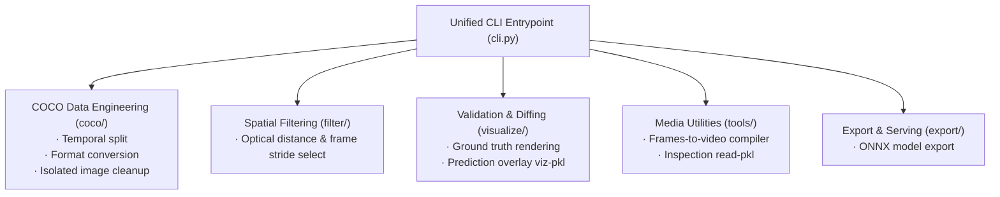

[简体中文](README.md) | English

# mmdetection_MOD · Data Pipeline & Keypoint Estimation

**Multi-class object detection, keypoint estimation, and engineering data pipelines based on mmdetection and YOLOX.**

This repository extends the official `mmdetection` ecosystem with a production-grade machine learning workflow tailored for multi-class object detection and keypoint estimation. To replace fragmented preprocessing scripts, resolve temporal data leaks, and eliminate hardcoded filepaths, the project packages all data engineering routines into a unified, modular Python CLI toolkit: **`mmdet-scripts`**.

---

## Architectural & Algorithmic Highlights

* **Timestamp-Aware Dataset Splitting**: Standard random frame shuffling causes severe data leakage across sequential automotive/surveillance footage. `mmdet-scripts split` clusters continuous frames by temporal proximity, ensuring linked sequences are assigned atomically to either train, validation, or test sets.
* **Rigorous Pinhole Camera Distance Filtering**: Replaces heuristic pixel metrics with formal geometric pinhole optics ($Distance = \frac{RealSize \times FocalLength}{PixelSize}$), effectively pruning low-confidence, long-range noisy targets.
* **Standardized COCO Keypoint Conversions**: Converts raw multi-class keypoint datasets into standard COCO JSON specifications with corrected polygon and bounding box area calculations.
* **Ground-Truth vs. Prediction Overlay Visualizations**: Ingests PyTorch model inference outputs (`.pkl`) and renders dual-layer visual comparisons directly against ground-truth COCO annotations.
* **Production Deployment Export**: Ships with `mmdet-scripts export-onnx` for straightforward conversion of trained PyTorch `.pth` weights into runtime-optimized ONNX computation graphs.

---

## Unified CLI Command Mapping

The refactored `mmdet-scripts` CLI replaces fragmented legacy scripts:

| Workflow Stage | Modern CLI Command | Capabilities |
| :--- | :--- | :--- |
| **Data Conversion** | `mmdet-scripts convert --variant keypoints` | Converts raw annotations into standard COCO Keypoint formats |
| **Temporal Split** | `mmdet-scripts split` | Partitions continuous video frames into Train/Val/Test clusters |
| **Distance Filter** | `mmdet-scripts select` | Filters samples via optical distance equations and bounding box limits |
| **Dataset Hygiene** | `mmdet-scripts cleanup` | Removes orphaned image files and dangling JSON annotations |
| **Truth Visualization**| `mmdet-scripts visualize` | Renders ground-truth bounding boxes and keypoint graphs |
| **Prediction Diffs** | `mmdet-scripts viz-pkl --compare` | Overlays model `.pkl` predictions against ground truth annotations |
| **Media Synthesis** | `mmdet-scripts to-video` | Compiles sequential image frames into demo video streams |
| **Graph Export** | `mmdet-scripts export-onnx` | Exports PyTorch checkpoint weights into deployment-ready ONNX |

---

## Quick Start

### Installation

```bash
# Recommended: Install inside your PyTorch / mmdetection environment
python -m pip install -e .
```

*Preprocessing, format conversion, and dataset partitioning rely purely on the standard library and `opencv-python-headless`. ONNX export requires PyTorch and mmdetection.*

### Common Pipeline Operations

```bash
# 1. Split sequential dataset using a 120s temporal clustering window
mmdet-scripts split J2camera_selected mmdetection/data --train-ratio 0.9 --val-ratio 0.05 --max-time-diff 120

# 2. Convert annotations to standard COCO Keypoint format
mmdet-scripts convert mmdetection/data/coco/train2017 mmdetection/data/coco/annotations --output instances_train2017.json --variant keypoints

# 3. Filter targets within a 50-meter optical threshold
mmdet-scripts select J2camera J2camera_filtered --max-distance 50 --interval 4

# 4. Compare model predictions against ground truth
mmdet-scripts viz-pkl results.pkl --compare --annotation-file instances_val2017.json --image-folder mmdetection/data/coco/val2017
```

---



* **`cli.py`**: Unified command-line interface entrypoint
* **`config.py`**: Category schemas and default hyperparameter configuration
* **`utils.py`**: File I/O utilities and 2D bounding box math
* **`coco/`**: Temporal clustering split, format conversion, and hygiene cleanup
* **`filter/`**: Optical distance gating and downsampling filters
* **`visualize/`**: Ground-truth visualization and PKL prediction diff overlay
* **`tools/`**: Frame-to-video assembler and quick PKL introspection
* **`export/`**: ONNX graph export with dynamic axes support

---

## License

This project is licensed under the [Apache 2.0 / MIT License](LICENSE).
