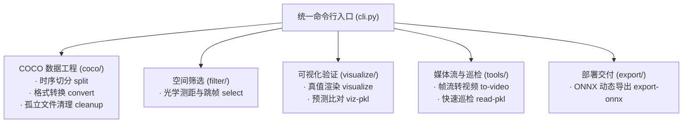

简体中文 | [English](README.en.md)

# mmdetection_MOD · 数据管线与关键点估计

**基于 mmdetection / YOLOX 的多类别目标检测、关键点估计与工程化数据管线**。

本仓库在官方 `mmdetection` 目标检测框架之上，深度扩展了面向多类别目标检测与人体/骑乘关键点联合估计的完整工业级研发流水线。为了解决学术与工程研发中数据清洗脚本碎片化、时序数据泄漏及硬编码参数的问题，本项目将全套离散预处理脚本重构封装为现代化的模块化 Python CLI 工具包 **`mmdet-scripts`**。

---

## 核心管线与算法重构亮点

* **科学的时序防泄漏切分（Timestamp-Aware Splitting）**：在连续车载/监控摄像头图像序列中，若随机抽样切分会导致极强的时间线过拟合。`mmdet-scripts split` 依据时间戳间隔自动聚合关联帧，确保同一组连续运动帧完整归入训练集或验证集。
* **严格的光学小孔测距过滤（Pinhole Camera Distance Modeling）**：纠正了早期脚本中像素高度比值的数学笔误，重构为严谨的针孔几何光学测距模型（$Distance = \frac{RealSize \times FocalLength}{PixelSize}$），精确剔除超视距低质量目标。
* **COCO 4 类 + 关键点标准化协议**：支持快速将非标原始检测与关键点数据转换为标准化 COCO 格式（涵盖标准检测、关键点联合标注及轻量 Mini 验证集变体），修复了历史面积（Area）计算的逻辑偏差。
* **端到端预测与真值对比可视化**：直接解析 PyTorch 模型输出的 `.pkl` 结果，支持与 COCO Ground Truth 图像执行同屏多类别重叠对比渲染与置信度过滤。
* **工程部署一键导出**：集成 `mmdet-scripts export-onnx`，无缝将训练后的 `.pth` 权重转化为端侧与推理引擎兼容的 ONNX 模型。

---

## CLI 命令映射总览

重构后的统一 CLI 命令（`mmdet-scripts`）全面替代以往零碎的根目录 Python 脚本：

| 业务环节 | 现代 CLI 命令 | 核心功能 |
| :--- | :--- | :--- |
| **格式转换** | `mmdet-scripts convert --variant keypoints` | 转换为 COCO 检测与关键点联合标注 |
| **数据集划分** | `mmdet-scripts split` | 按时间戳连续聚类切分 Train / Val / Test |
| **距离筛选** | `mmdet-scripts select` | 基于针孔光学公式与检测框尺度筛选高质量样本 |
| **数据清洗** | `mmdet-scripts cleanup` | 扫描并清理孤立图片与无图残留 JSON |
| **标注可视化** | `mmdet-scripts visualize` | 渲染 Ground Truth 边界框与关键点图层 |
| **推理比对** | `mmdet-scripts viz-pkl --compare` | 将模型预测 `.pkl` 与真值框进行叠层对比渲染 |
| **媒体工具** | `mmdet-scripts to-video` | 将有序图像检测帧流合成 demo 视频 |
| **模型导出** | `mmdet-scripts export-onnx` | 将 PyTorch `.pth` 模型权重导出为 ONNX 计算图 |

---

## 快速开始

### 安装数据管线 CLI

```bash
# 建议在包含 PyTorch 与 mmdetection 的虚拟环境中安装
python -m pip install -e .
```

*数据清洗、转换与切分工具仅依赖 Python 标准库与 `opencv-python-headless`；模型导出需要 PyTorch 与 mmdetection 环境。*

### 典型工作流示例

```bash
# 1. 按时序聚合切分原始数据集（90% 训练集, 5% 验证集, 120s 聚类窗口）
mmdet-scripts split J2camera_selected mmdetection/data --train-ratio 0.9 --val-ratio 0.05 --max-time-diff 120

# 2. 转换为带关键点标注的 COCO 实例文件
mmdet-scripts convert mmdetection/data/coco/train2017 mmdetection/data/coco/annotations --output instances_train2017.json --variant keypoints

# 3. 筛选有效距离在 50 米内的关键目标
mmdet-scripts select J2camera J2camera_filtered --max-distance 50 --interval 4

# 4. 可视化模型推理结果与真实标注对比
mmdet-scripts viz-pkl results.pkl --compare --annotation-file instances_val2017.json --image-folder mmdetection/data/coco/val2017
```

---



* **`cli.py`**：统一命令行入口
* **`config.py`**：类别元数据与默认超参数
* **`utils.py`**：文件 I/O 与几何计算通用工具
* **`coco/`**：数据集时序切分、格式转换与垃圾清理
* **`filter/`**：光学距离与时间跨度筛选
* **`visualize/`**：真值可视化与 PKL 预测叠层对比渲染
* **`tools/`**：帧流转视频与 PKL 快速巡检
* **`export/`**：ONNX 模型导出与动态尺寸配置

---

## 许可证

本项目基于 [Apache 2.0 / MIT License](LICENSE) 开源。
